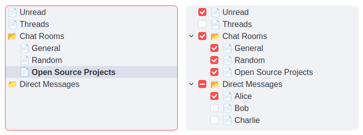

# streamlit-arborist

[](https://github.com/gabriel-msilva/streamlit-arborist/actions/workflows/test-build-release.yaml)


_streamlit-arborist_ is a [Streamlit](https://streamlit.io) component based on
[react-arborist](https://github.com/brimdata/react-arborist) for visualizing
hierarchical data structures as interactive tree views.

- **Demo application**: [st-arborist-example.streamlit.app](https://st-arborist-example.streamlit.app/)
- **Documentation**: [streamlit-arborist.readthedocs.io](https://streamlit-arborist.readthedocs.io/)



## Installation

```sh
pip install streamlit-arborist
```

## Basic usage

A minimal `app.py` file with sample data:

```python
from streamlit_arborist import tree_view, tree_checkbox

data = [
   {
      "id": "1",
      "name": "Parent 1",
      "children": [
         {"id": "1.1", "name": "Child 1"},
         {"id": "1.2", "name": "Child 2"}
      ]
   },
   {
      "id": "2",
      "name": "Parent 2",
      "children": [
         {"id": "2.1", "name": "Child 3"},
         {"id": "2.2", "name": "Child 4"}
      ]
   }
]

tree_view(data)
tree_checkbox(data)
```

Run Streamlit:

```sh
streamlit run app.py
```

See the [Reference API](https://streamlit-arborist.readthedocs.io/stable/api.html)
for all available parameters.

## Contributing

Contributions are welcome! See the
[contributing guide](https://github.com/gabriel-msilva/streamlit-arborist/blob/main/CONTRIBUTING.md)
to set up a development environment, run the example app and tests, and build the package.
